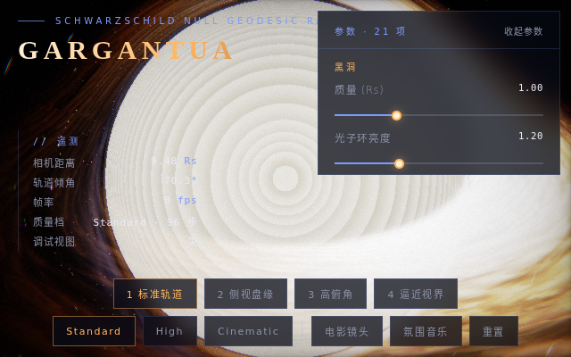

# GARGANTUA

> Schwarzschild 黑洞零测地线光线追踪器 — 一个纯静态、可直接在浏览器运行的黑洞实时渲染页面。

<p align="center">
  
</p>

## 简介

GARGANTUA 使用 WebGL2 + 自定义 GLSL 着色器，在片元着色器中逐步积分 Schwarzschild 度规下的零测地线，实时渲染黑洞、吸积盘与引力透镜效果。没有构建步骤，没有框架依赖——打开一个静态服务器即可运行。

除渲染外还包含：OrbitControls 自由视角、电影镜头、氛围音乐、实时参数面板、HUD 遥测、9 种调试视图、画质档位、状态持久化，以及供自动化截图使用的 URL 接口。

## 特性

- **物理正确性**：在轨道平面内严格积分零测地线方程
  `d²x/dλ² = -(3/2)·Rs·h²·x / |x|⁵`，其中 `h = x × v` 为守恒比角动量；光子球位于 `r = 1.5 Rs`，事件视界位于 `r = Rs`。
- **吸积盘**：内外缘半径可调，带湍流扰动、轨道流速、Doppler 增亮与引力红移。
- **深空背景**：星空密度与银河亮度可调。
- **后期处理**：Bloom、ACES 色调映射、色散、胶片颗粒、暗角、曝光。
- **双通道渲染**：通道一输出线性 HDR 光线追踪结果，通道二完成 Bloom 合成与后期。
- **21 项实时参数**：分为黑洞、吸积盘、深空背景、镜头与后期四组，拖动即时生效并自动持久化到 `localStorage`。
- **4 个视角预设** + 3 档画质（Standard / High / Cinematic）。
- **调试视图**：9 种（步数热力、最近接近、穿越次数、仅星空、仅吸积盘、光子环、视界掩码、偏折角、原始 HDR）。

## 快速开始

这是一个纯静态项目，但由于使用 ES Module + importmap，**不能直接双击 `index.html`（`file://` 协议会被浏览器拦截）**，需要起一个本地 HTTP 服务：

```bash
# 任选其一
python -m http.server 8734
npx serve -l 8734
```

然后打开 <http://127.0.0.1:8734/index.html>。

> **单文件版**：`index-standalone.html` 将页面样式与脚本内联为一个文件，Three.js 通过 jsDelivr / unpkg 双 CDN 加载（可自动切换）。适合分享或离线场景，但需联网。

浏览器需支持 **WebGL2**（Chrome / Edge / Firefox / Safari 新版均可）。

## 操作说明

| 操作 | 功能 |
| --- | --- |
| 鼠标拖拽 / 滚轮 | 旋转视角 / 缩放 |
| `1` `2` `3` `4` | 视角预设：标准轨道 / 侧视盘缘 / 高俯角 / 逼近视界 |
| `D` 然后 `0`–`9` | 切换调试视图（`D` 单独按可退出调试） |
| `C` | 电影镜头（自动环绕） |
| `M` | 氛围音乐开关 |
| `H` | 显示 / 隐藏 HUD |
| `F` | 全屏 |
| `R` | 重置视角与参数 |
| `Esc` | 退出调试视图 |

## URL 参数

适合做自动化截图 / 分享固定画面：

| 参数 | 说明 | 示例 |
| --- | --- | --- |
| `shot=1` | 开启截图模式，渲染稳定后置 `window.__SHOT_READY__ = true`，并将 `document.title` 改为 `GARGANTUA_READY` | `?shot=1` |
| `t=秒` | 冻结动画时间，得到确定性画面 | `?shot=1&t=30` |
| `preset=0..3` | 指定视角预设 | `?preset=2` |
| `quality=standard\|high\|cinematic` | 指定画质档 | `?quality=cinematic` |
| `debug=0..9` | 指定调试视图 | `?debug=6` |

完整示例：

```
http://127.0.0.1:8734/index.html?shot=1&t=30&preset=2&quality=cinematic&debug=0
```

参数优先级：**URL 参数 > localStorage > 默认值**。

## 测试

`tests/shot.mjs` 是一个基于 Playwright 的无头验收脚本，检查：无控制台错误、画面非黑屏、URL 截图接口可用、预设切换与拖拽交互正常。

```bash
npm install --no-save playwright
npx playwright install chromium

# 先启动静态服务器，再运行
python -m http.server 8734
node tests/shot.mjs http://127.0.0.1:8734
```

脚本默认连接 `http://127.0.0.1:8734`，也可以直接传其它地址。截图与 `report.json` 输出到 `tests/artifacts/`。退出码 `0` 表示通过。若需要指定浏览器可执行文件，设置环境变量 `CHROME_PATH`。

## 项目结构

```
gargantua/
├── index.html                # 主页面（ES Module + importmap）
├── index-standalone.html     # 单文件版（Three.js 走 CDN）
├── css/
│   └── style.css             # 界面与 HUD 样式
├── js/
│   ├── main.js               # 主程序：状态、交互、渲染循环、截图接口
│   └── shaders.js            # GLSL：测地线追踪 + 后期合成
├── vendor/
│   ├── three.module.js       # three.js r160
│   └── OrbitControls.js      # 相机控制
├── assets/
│   └── ambient.wav           # 氛围音乐
└── tests/
    ├── shot.mjs              # Playwright 无头验收
    └── artifacts/            # 截图与报告输出
```

## 技术栈

- **three.js r160**（vendored，无需联网）
- **WebGL2 / GLSL ES 3.0**：片元着色器内光线步进
- 原生 ES Modules + importmap，无打包工具

## 说明与限制

- 画面完全由 GPU 实时计算，性能取决于显卡；软渲染（SwiftShader）下可能需要降低画质档位。
- 音乐轨 `assets/ambient.wav` 约 6.4 MB，仓库体积主要来自该文件。

## 许可证

本仓库未附带 LICENSE 文件。如无特别声明，默认保留所有权利；如需允许他人使用、修改或再分发，可补充相应开源协议（例如 MIT）。
